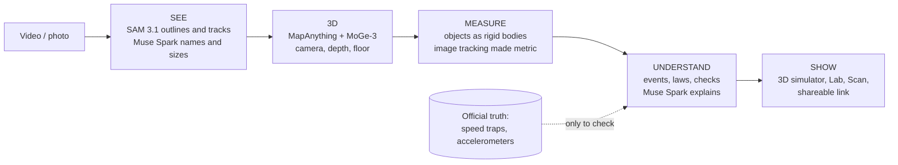

# PhysLens

**Video in, measured physics out.** PhysLens turns ordinary video (or one photo) into measured 3D points, follows
each object as one solid body moving over time, finds the physical events (contact, crush, rebound, turn), and
explains them, with every number checked against what was measured. Built for the Meta Global AI Developer
Hackathon (Indie track) on Meta's **SAM 3.1** and **Muse Spark** (plus Muse Voice), with MapAnything and MoGe-3
for 3D.

## What it gets right (checked against official measurements)

| Event (public footage) | Measured from video | Official |
|---|---|---|
| NHTSA 9070: SUV into a rigid wall, 1,000 fps | approach **56.81 km/h**, crush **0.728 m at 75 ms**, crush curve within 1.5 cm | 56.55 km/h, 0.707 m at 74.1 ms (accelerometers) |
| NHTSA 15756: car sideways into a pole, overhead | **31.29 km/h**, travelling at **74.6°** to its axis | 31.09 km/h, 75° |
| NHTSA 8555: pickup into the back of a standing SUV | approach **69.09 km/h**; SUV's speed change **+47.4 km/h**; momentum balance 0.954 | 69.1 km/h; +47.8; 1.013 (accelerometers) |
| NHTSA 10072: moving barrier into a car at 15° | approach **90.72 km/h**; barrier's slowing within 1.6 km/h for 40 ms | 90.33 km/h (speed trap), accelerometer |
| 11foot8 bridge: box truck under a 3.556 m beam | impact at frame 196.6, clearance 3.63 m, truck flagged too tall | hand label 196–200, sign 3.556 m |
| Classroom ball drop (Lab) | g = 9.73 ± 0.21 m/s², next bounce called before it happened | 9.81 |

What doesn't work yet is written down too: [benchmark/EVENTS.md](benchmark/EVENTS.md) ("What failed, and why").

## Try it in 5 minutes
```bash
# 1. Engine (Python 3.11)
cd backend
uv venv --python 3.11 .venv
uv pip install --python .venv/bin/python -r requirements.txt
cp .env.example .env            # optional: add your Meta API key; without it everything runs offline
.venv/bin/python -m physlens.cli samples
.venv/bin/uvicorn physlens.api:app --port 8000

# 2. Web app (second terminal)
cd web
pnpm install
pnpm dev                        # http://localhost:5173  (3D simulator: http://localhost:5173/sim.html)
```
Then follow the demo script: **[docs/DEMO.md](docs/DEMO.md)**.

## Documentation
| Read this | For |
|---|---|
| [docs/DEMO.md](docs/DEMO.md) | Step-by-step demos (5-minute judges' demo, Lab, Scan, 3D simulator), what costs money |
| [docs/ARCHITECTURE.md](docs/ARCHITECTURE.md) | How the system flows, with diagrams: end to end, the simulator core, Lab, Scan, where it runs |
| [docs/USE_CASES.md](docs/USE_CASES.md) | Who it's for and what works today vs next |
| [docs/SETUP.md](docs/SETUP.md) | Full setup: keys, GPU worker, datasets, tests, how to add a new test case |
| [CONTRIBUTING.md](CONTRIBUTING.md) | How the team works: branches, commits, rules for keys, data and claims |
| [docs/FEATURES.md](docs/FEATURES.md) | Every feature in detail (Lab experiments, Scan, voice, records, MuJoCo) |
| [benchmark/EVENTS.md](benchmark/EVENTS.md) | Every crash test, measured vs official, and what failed |
| [docs/architecture.html](docs/architecture.html) | The illustrated architecture page (open in a browser) |

## The system in one picture

Details and more diagrams: [docs/ARCHITECTURE.md](docs/ARCHITECTURE.md).

## Repository map
```
backend/physlens/     the engine (FastAPI): perception (SAM 3.1), geometry client (GPU), physics, labs, scan,
                      3D worlds (pointworld, objsim, events3d), hybrid motion measurement (hybrid.py), voice/ask
backend/tests/        offline tests (no keys, no network)
web/                  React + three.js app: Lab, Scan, 3D world; sim.html = the standalone 3D simulator
benchmark/            one script per real test case, its results (.json) and write-ups (*.md)
gpu_worker/           the RunPod GPU worker (MapAnything + MoGe-3); deployed from its own GitHub repo
scripts/              fetch_datasets.py: downloads the public footage the benchmarks use
docs/                 documentation and diagrams
samples/, real_clips/ small clips shipped with the repo (synthetic tests, a real classroom drop, scan photos)
datasets/, records/, media/   not in git: downloaded footage, caches, generated 3D worlds
```

## Data and credits
All footage is public: NHTSA Vehicle Crash Test Database (public, credited; downloaded by
`scripts/fetch_datasets.py`, except one camera-15 clip of test 9070 that ships in `samples/` for the Lab's crash
demo), NASA (public domain), Wikimedia Commons (CC BY, credited in each `datasets/*/SOURCE.md`), and a ComPADRE
classroom clip (CC BY 3.0, `real_clips/compadre-bouncing-ball/SOURCE.md`). Models: SAM 3.1 and Muse Spark/Voice
(Meta Model API), MapAnything (Meta, Apache-2.0 checkpoint), MoGe-3 (Microsoft, MIT).
