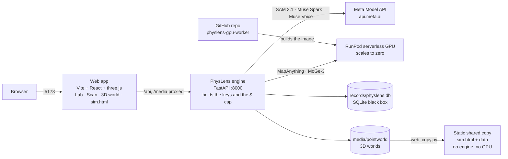
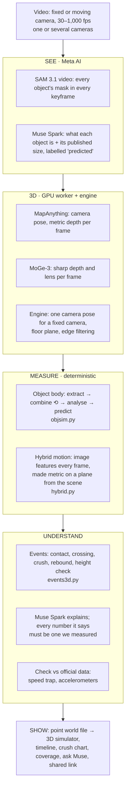
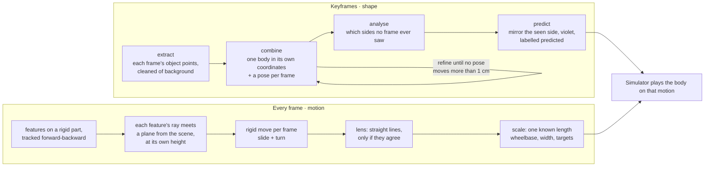
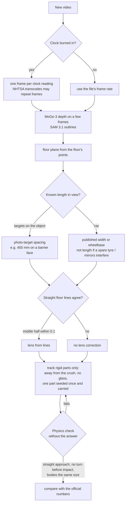
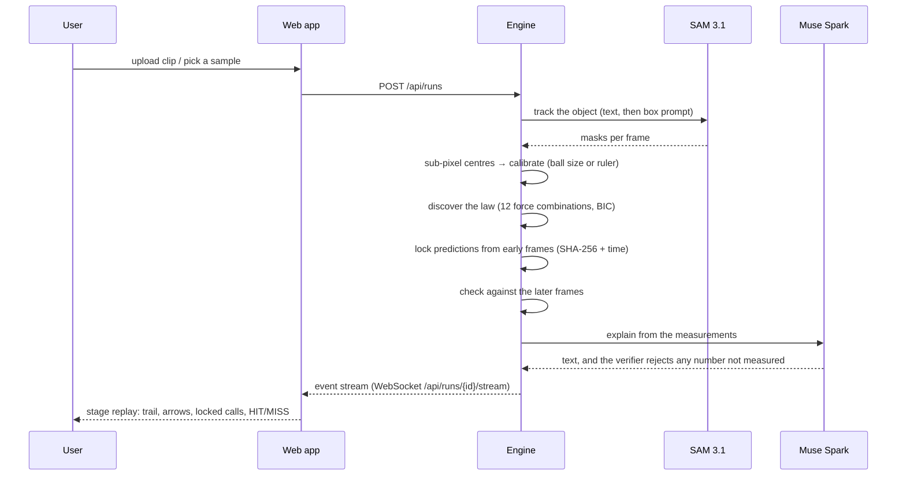
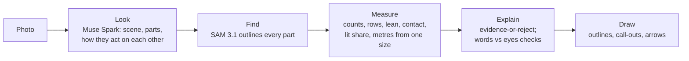

# How PhysLens works

PhysLens has three ways in (a **video** for the 3D simulator, a **clip** for the Lab, a **photo** for Scan) and one
rule throughout: **AI sees, deterministic code measures, official data only checks.** Meta's models find and name
things; the numbers come from geometry and physics we can inspect; ground truth (speed traps, accelerometers) is
never an input, only the thing we compare with at the end.

The diagrams below are Mermaid (GitHub draws them). An illustrated version: [architecture.html](architecture.html).

## 1. Where everything runs

- Keys live only in `backend/.env` (git-ignored). The browser never sees them.
- Every Meta call is priced and logged (`backend/.spend.jsonl`); calls stop at `PHYSLENS_BUDGET_USD` (default $50).
- The GPU worker runs only when called (min 0 workers, 60 s idle), so it costs nothing while idle.

## 2. From video to an explained 3D world (end to end)

## 3. The simulator core: one solid body, moving over time
Two lanes from the same video. Keyframes give **shape**; every frame gives **motion**.

Why two lanes: per-frame AI depth jitters by about 10 cm, more than a crash moves between 1 ms frames. Image
tracking lands within a fraction of a pixel, so motion comes from the image and only the plane, lens and one
length come from 3D. (Lessons behind each choice: [benchmark/EVENTS.md](../benchmark/EVENTS.md).)

## 4. How a new crash video is measured (the method, as a decision flow)

## 5. Lab: a clip becomes locked predictions

## 6. Scan: a photo becomes measurements

## 7. Code map
| Piece | Files |
|---|---|
| API and orchestration | `backend/physlens/api.py`, `pipeline.py`, `events.py` |
| Meta models | `perception/sam_tracker.py` (video), `perception/sam_image.py` (photo), `agent/agent.py`, `agent/verifier.py`, `ask.py`, `voice.py`, `priors.py` |
| 3D from the GPU | `geometry/client.py` (MapAnything, MoGe-3 on RunPod), `gpu_worker/` |
| Moving / fixed camera geometry | `moving_camera.py`, `sharp.py`, `objfuse.py`, `vehicle3d.py` |
| Point worlds and bodies | `pointworld.py` (file format `physlens-pointworld/1`), `objsim.py` (extract → combine → analyse), `events3d.py` |
| Hybrid motion | `hybrid.py`: `track_part`, `track_rigid`, `lens_from_lines`, `fit_distortion`, `plane_point` |
| Lab physics | `physics/` (calibration, bounces, law discovery), `labs/` (cup, cans, springs, crash), `ledger.py` |
| Records, replay, sims | `recorder.py`, `replay.py`, `scene.py`, `sim_mujoco.py` |
| Scan | `scan.py` |
| Web | `web/src/App.tsx` (Lab/Scan), `PointWorld.tsx` (3D simulator), `sim.tsx` + `web/sim.html` (standalone) |
| Real test cases | `benchmark/*.py`, one per event; results in `benchmark/*.json`; write-up in `benchmark/EVENTS.md` |

## 8. The point world file (`physlens-pointworld/1`)
A JSON header plus a binary of int16 positions, RGB colours and a group tag per point:
- tag 255: the static scene; per-moment tags: an object at each keyframe
- 254: the object's combined body (real colours); 253: the same body coloured by how many frames saw each spot
- 252: predicted points (the side no camera saw), drawn violet
- `notes`: events, rigid body poses, structures, coverage, priors, truth table, crush curve, explanation, cameras
